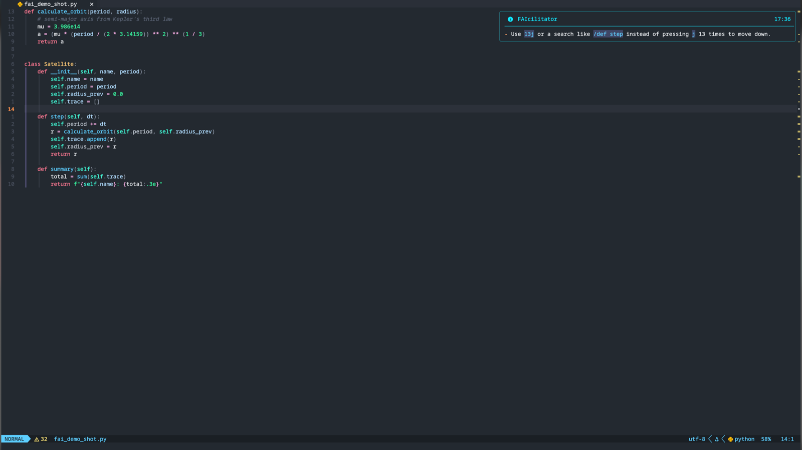
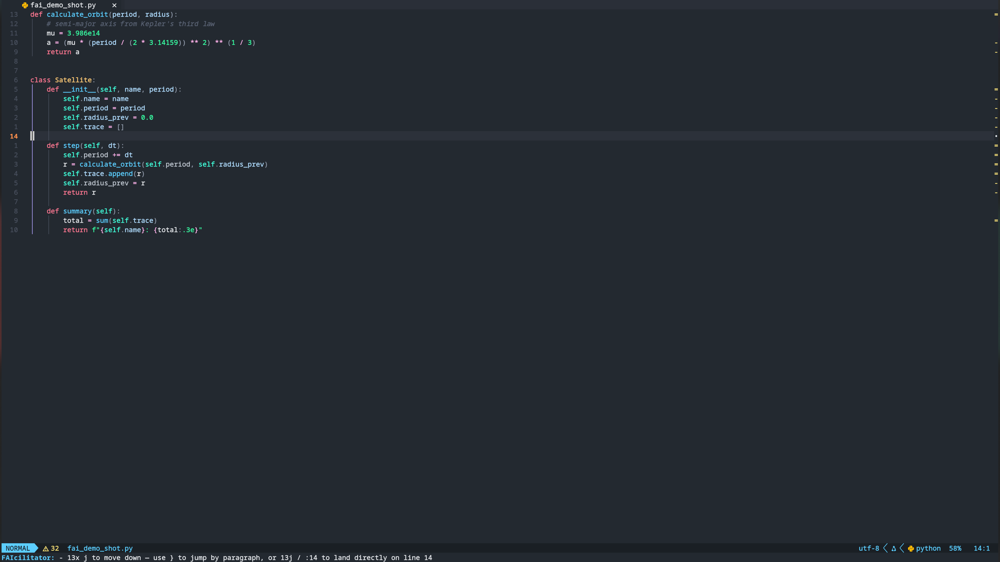
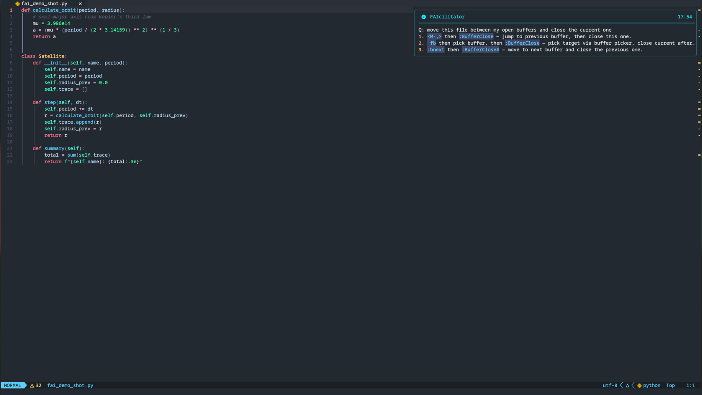
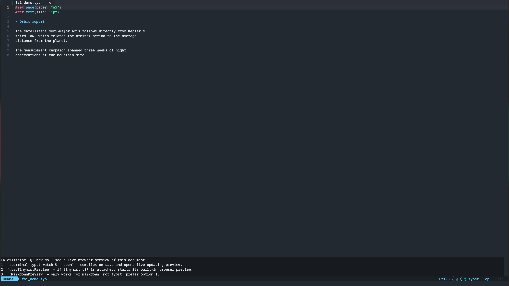
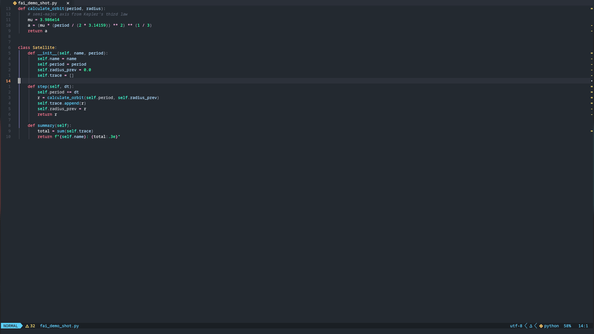
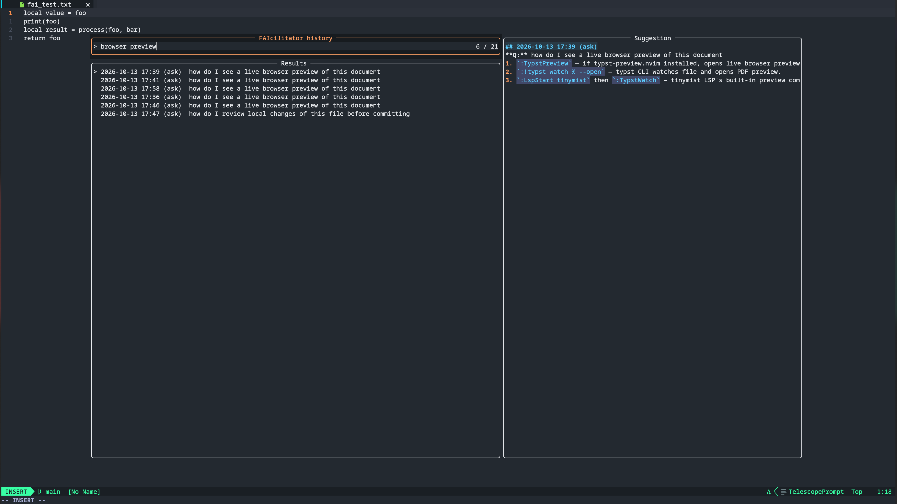

# FAIcilitator.nvim

Watches how you use Neovim (configurably), periodically asks an
OpenAI-compatible LLM how you could have done the same thing faster, and shows
brief, non-invasive notifications with concrete suggestions — counts, text
objects, `.`, macros, motions you forgot existed.

Teaching, not nagging.

### Analysis and Ask, in both display styles

|                                                     |                                                     |
| --------------------------------------------------- | --------------------------------------------------- |
|  |  |
| analysis, `display = "notify"`                      | analysis, `display = "echo"`                        |
|  |  |
| ask, `display = "notify"`                           | ask, `display = "echo"` (non-blocking bottom float) |

## Features

- **Configurable recording** — keypresses, `:ex` commands, searches, yanks and
  buffer switches can each be toggled on/off.
- **Two automatic triggers** — an activity timer and an event-count threshold,
  whichever fires first, plus a hard cooldown between runs.
- **Manual analysis** — `:FAIcilitator` AI-reviews your recent activity on
  demand.
- **Ask anything** — `:FAIcilitatorAsk` answers "how do I…?" questions with
  the exact keystrokes, using your buffer context.
- **Config-aware** — the model can see your keymaps (compact or full), user
  commands and installed plugins, so suggestions use what *you* actually
  have instead of vanilla defaults.
- **Two display modes** — floating notification via `vim.notify`, or quiet
  messages in the echo area below the statusline (`display = "echo"`).
- **Brief toasts** — max 3 suggestions via `vim.notify` (snacks.notifier,
  nvim-notify or the built-in renderer all work); full history in
  `:FAIcilitatorLog`.
- **Persistent history** — every suggestion is appended to a JSONL file;
  `:FAIcilitatorLog` shows all of it, restarts included, as a fuzzy-searchable
  Telescope picker (one row per request, full markdown preview) when
  Telescope is installed, a plain split otherwise.
- **Zero hard dependencies** — only `curl` and Neovim ≥ 0.10 (telescope.nvim
  optional; the log falls back to a plain split without it).
- **Any OpenAI-compatible endpoint** — OpenAI, Ollama, llama.cpp, LiteLLM
  gateways… endpoint, model, key and extra request parameters are all yours.

> **Toast truncation:** some notifier plugins render one-line compact
> toasts (e.g. snacks.notifier defaults to `style = "compact"`, truncating
> long messages with `…`). Use a wrapping style (`style = "fancy"` for
> snacks) if you want the full text inline — `:FAIcilitatorLog` always has
> the untruncated version regardless.

## Requirements

- Neovim ≥ 0.10
- `curl` on `$PATH`
- An API key for an OpenAI-compatible `/chat/completions` endpoint

## Installation

### [vim.pack](https://neovim.io/doc/user/pack.html#vim.pack) (Neovim ≥ 0.12)

```lua
vim.pack.add({ "https://github.com/pviscone/FAIcilitator.nvim" })
```

### lazy.nvim

```lua
{ "pviscone/FAIcilitator.nvim" }
```

Any other plugin manager works the same; see below for setup.

## Quickstart

```lua
require("faicilitator").setup({
	ai = {
		endpoint = "https://api.openai.com/v1",
		model = "gpt-5.1",
		api_key = nil, -- or "sk-..."; falls back to $FAICILITATOR_API_KEY
	},
})
```

That's the minimum: `ai.endpoint` and `ai.model` are required, everything else
has defaults.

Load eagerly (do **not** lazy-load) — recording must start at startup.

## Configuration

Defaults, annotated:

```lua
require("faicilitator").setup({
	enabled = true,
	record = {
		keys = false, -- typed text (insert/replace); off by default: motions only
		commands = true, -- :ex commands and /? searches
		yanks = false, -- yank/delete operators
		buffers = false, -- buffer switches (leaks file names to the endpoint)
	},
	max_events = 2000, -- raw events kept in the ring buffer
	transcript_events = 300, -- aggregated lines sent per analysis
	timer = { interval = 5, min_events = 1 }, -- every N seconds, if ≥ min_events new activity
	events = { threshold = 10 }, -- OR every N recorded events, whichever first
	cooldown = 5, -- hard minimum seconds between two analyses
	idle_ms = 1500, -- auto-analysis waits until this long after your last recorded event
	history = { -- :FAIcilitatorLog content, persisted across restarts
		persist = true,
		file = vim.fn.stdpath("data") .. "/faicilitator_history.jsonl",
		max_file_kb = 256, -- rotated to the newest half when exceeded
	},
	notify = { level = vim.log.levels.INFO, max_suggestions = 3 },
	display = "echo", -- "notify": vim.notify toast | "echo": message area below the statusline
	context = {
		buffer_lines = 3, -- buffer lines each side of the cursor sent as context (0 = off)
		register = true, -- also send the last yank/delete content
	},
	awareness = { -- how much of YOUR config the model sees (keymaps/commands/plugins)
		analysis = { keymaps = "compact", commands = true, plugins = false },
		ask = { keymaps = "full", commands = true, plugins = true, docs = true },
	},
	ai = {
		endpoint = nil, -- REQUIRED, openai-compatible base URL
		model = nil, -- REQUIRED, model served by that endpoint
		api_key = nil, -- resolved: this field, then $api_key_env
		api_key_env = "FAICILITATOR_API_KEY",
		params = {}, -- extra request-body fields, e.g. { reasoning_effort = "none" }
		temperature = 0.2, -- sampling temperature (params.temperature overrides on merge)
		timeout = 30, -- seconds for the curl call
	},
	-- deep-merged over `ai` per call path (nil = use `ai` as-is): different
	-- model — or a different mode of the same model — per scope
	ai_analysis = nil, -- e.g. a cheap/fast model for the frequent auto-analysis
	ai_ask = { params = { reasoning_effort = "low" } }, -- more thinking for asks
})
```

Since `ai_analysis`/`ai_ask` are deep merges, you can change only what
differs — just `params` to vary a mode of the same model, or
`endpoint`+`model`+`api_key` for a whole different provider per scope.

`awareness.ask.docs = true` adds **doc retrieval at ask time**: the question's
keywords (plus plugin-name matches) are scored against every installed
plugin's `doc/*.txt`, and the top snippets are sent with the question. No
background calls, no cache, no extra cost — the model answers from the real
docs of otherwise-unknown plugins.

Tune frequency with `timer` + `events` + `cooldown`. Tune cost with
`transcript_events` and the model. Tune noise with `notify.max_suggestions`.
Tune motion habits the AI looks for via the `record` block.

## Commands

|                             |                                                                             |
| --------------------------- | --------------------------------------------------------------------------- |
| `:FAIcilitator`             | analyze recent activity now (ignores cooldown)                              |
| `:FAIcilitatorLog`          | persisted history — fuzzy-searchable Telescope picker (markdown split fallback) |
| `:FAIcilitatorToggle`       | pause/resume recording and analysis                                         |
| `:FAIcilitatorAsk [question]` | ask how to do something, the best vim way; no args → input prompt. Asked while a request is in flight? It queues (max 3) and answers next |

## :FAIcilitatorAsk



Answers are grounded in the current buffer context (cursor lines, register)
and in your config inventory (your keymaps, commands, installed plugins —
see `awareness`) — here it suggested a scoped substitute using the actual
line range under the cursor.



## Privacy — read before enabling

Every analysis sends a transcript of your recent activity — keypresses, ex
commands, search patterns — to the configured endpoint. That can include
fragments of text you typed, search terms, and file paths from commands.

Mitigations and default leak surface:

- **typed text is never recorded by default** (`record.keys = false` — only
  normal-mode motions are tracked; set true to include insert-mode typing)
- **terminal-mode input is never recorded** (sudo prompts, plain shells)
- **typing into the `:FAIcilitatorAsk` prompt is never recorded** (asking a
  question is not editing behavior)
- **cmdline keystrokes are never recorded** as keys (only the final command)
- `record.buffers` / `record.yanks` are **off by default**
- **`context.buffer_lines` (3) and `context.register` are ON by default** —
  buffer text around the cursor and your last yank are sent to ground
  suggestions; set `0`/`false` to disable
- `awareness` sends your keymap list, command names and plugin names;
  `awareness.ask.docs` additionally sends matched snippets from installed
  plugins' docs
- `:FAIcilitatorToggle` pauses everything for sensitive sessions

Point it at a local LLM (Ollama, llama.cpp server) to keep everything on your
machine.

## How it works

```
vim.on_key + autocmds ──▶ ring buffer (max_events) ──▶ aggregated transcript
                                                         (x-counts, timestamps)
brief vim.notify ◀── JSON array parse ◀── POST /chat/completions ◀── + filetype
     toast                                    (async via curl)
```

Consecutive identical keys are collapsed (`j` ×12) before sending, so the model
sees `key(n): j (x12)` and answers _"use 12j"_ instead of raining tokens on 12
single lines.

## License

AGPL-3.0 — see [LICENSE](LICENSE).
